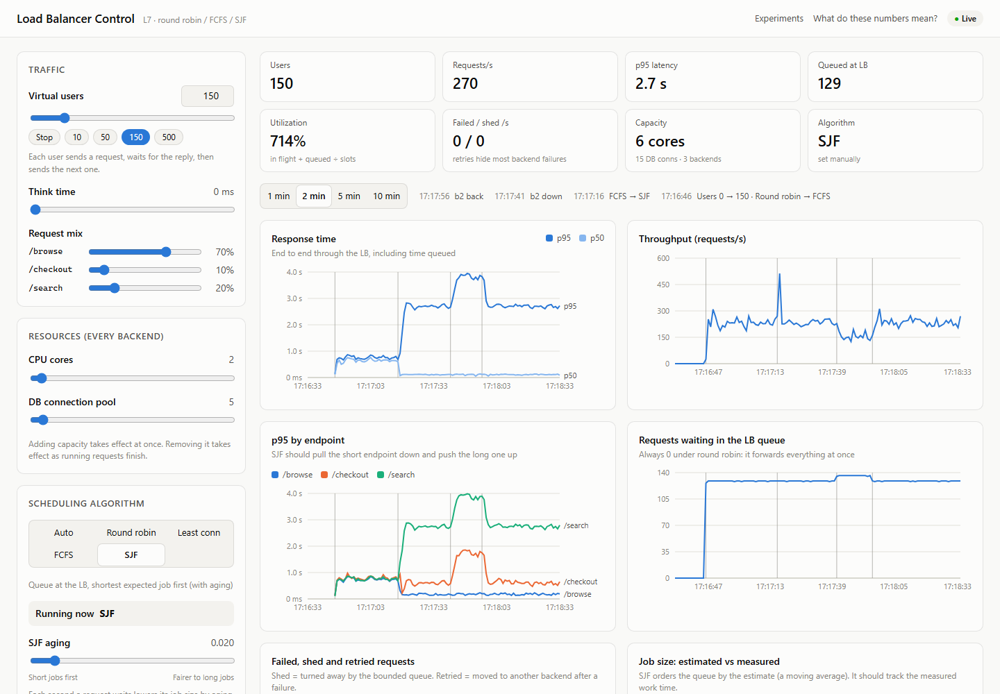
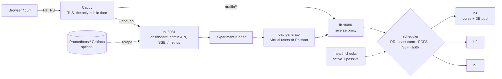
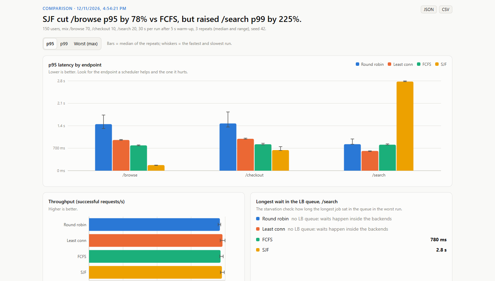
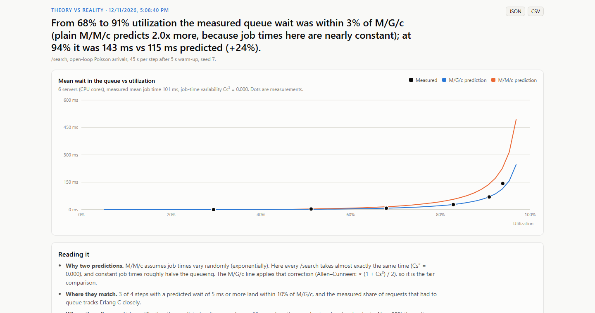

# L7 load balancer with live scheduling experiments

**Shortest-job-first cut `/browse` p95 latency by 78% under overload (787 → 174 ms), and made the longest jobs wait 3× longer (`/search` p99 867 → 2,819 ms).** Without aging it starved them outright: about 230 `/search` requests per 30-second run hit the 10 s queue timeout and were dropped.

This repository is a working layer-7 load balancer in Go, with five scheduling strategies, failover, retries and load shedding. It comes with a React dashboard to drive it live and a controlled-experiment runner that produced the numbers above. It runs in Docker on AWS EC2 behind Caddy with automatic HTTPS.

**Live demo:** https://13-54-72-78.sslip.io · [Dashboard](https://13-54-72-78.sslip.io/dashboard) · [Experiments](https://13-54-72-78.sslip.io/experiments)



## Architecture



Each box is its own container: `caddy`, `lb`, `b1`, `b2` and `b3`, built from one image. Only Caddy publishes ports.

## The evidence

All numbers come from the built-in experiment runner. Each configuration gets **the same load (150 users), the same seeded request sequence, a 5 s warm-up and a 30 s run**, the run order rotates between repeats, and every value is the **median of 3 repeats** with its range in the raw data. Setup: 3 backends × (2 cores, 5 DB connections), mix 70% `/browse` (~20 ms), 10% `/checkout` (~55 ms), 20% `/search` (100 ms CPU). Measured on a 24-core desktop.

| Configuration | Requests/s | `/browse` p95 | `/checkout` p95 | `/search` p99 | Worst `/search` wait in queue |
|---|---:|---:|---:|---:|---:|
| Round robin | 231 | 1,451 ms | 1,471 ms | 1,041 ms | (no LB queue) |
| Least connections | 235 | 955 ms | 995 ms | 689 ms | (no LB queue) |
| FCFS | 232 | 787 ms | 822 ms | 867 ms | 0.8 s |
| SJF, aging 0.02 | 234 | **174 ms** | 641 ms | 2,819 ms | 2.8 s |



**Starvation and the aging fix** (separate run, same method):

| Configuration | `/browse` p95 | `/search` p99 | Worst `/search` wait | `/search` requests dropped (timed out) per run |
|---|---:|---:|---:|---:|
| FCFS | 775 ms | 866 ms | 0.8 s | 0 |
| SJF, no aging | **150 ms** | 8,245 ms | 9.9 s | **~231** |
| SJF, aging 0.02 | 172 ms | 2,834 ms | 2.8 s | 0 |
| SJF, aging 0.1 | 652 ms | 1,570 ms | 1.5 s | 0 |

**What this shows**

1. **Throughput is the same everywhere (~232 req/s).** The schedulers don't do more work; they decide *who* waits. Pure SJF's slightly higher number (256) came from dropping long jobs.
2. **Least connections beats round robin on every endpoint.** Round robin can't see that one backend is stuck with slow jobs.
3. **SJF is a trade-off, not a win.** Aging is the dial between "short jobs first" and "fair to long jobs".

**Theory vs reality (M/M/c).** Open-loop Poisson arrivals into one FIFO queue in front of all 6 CPU cores (FCFS, one LB slot per core), `/search` only: measured job time 100.5 ms and almost constant (Cs² ≈ 0), 45 s per step.

| Utilization (measured) | Measured mean queue wait | M/G/c prediction (Allen–Cunneen) | M/M/c prediction (Erlang C) | Share that queued: measured / Erlang C |
|---:|---:|---:|---:|---:|
| 29% | 0.1 ms | 0.1 ms | 0.2 ms | 1% / 1% |
| 51% | 3.1 ms | 1.9 ms | 3.7 ms | 13% / 11% |
| 68% | 7.7 ms | 7.9 ms | 15.9 ms | 28% / 30% |
| 83% | 27.4 ms | 28.3 ms | 56.6 ms | 57% / 58% |
| 91% | 69.3 ms | 69.9 ms | 139.9 ms | 73% / 76% |
| 94% | 143.1 ms | 115.0 ms | 230.1 ms | 85% / 84% |



- **Between 68% and 91% utilization, the measurement is within 3% of M/G/c.**
- **Plain M/M/c predicts twice the wait.** It assumes exponentially distributed job times, and constant job times halve the queueing ((1 + Cs²)/2 = 0.5).
- **It diverges at the edges.** Below a few milliseconds, timer and network noise is as large as the effect. At 94% the wait is driven by rare bursts, so 45 s is a small sample and the approximation is at its weakest.

Raw results (JSON and CSV) are in [`docs/results/`](docs/results/).

## How it works

| Algorithm | Picks the next request by | Picks the backend by | LB queue |
|---|---|---|---|
| Round robin | arrival (forwards at once) | next in turn | no |
| Least connections | arrival (forwards at once) | fewest in flight ÷ slots | no |
| FCFS | oldest first | least loaded with a free slot | yes, bounded |
| SJF | smallest expected job, minus aging × time waited | least loaded with a free slot | yes, bounded |
| Auto | RR below 90% utilization; above it SJF if job sizes differ ≥ 2×, else FCFS; back to RR below 60% | | |

- **Job sizes** are learned per URL as a moving average of the work time each backend reports in a standard `Server-Timing: work;dur=…` header. The first version timed requests at the load balancer instead. Under load that time was mostly queueing inside the backend, so `/browse` looked slower than `/search`, SJF ran the longest jobs first, and throughput fell to 70 req/s. That bug is why the header exists.
- **Slots:** each backend gets cores + DB-pool slots. Beyond that, FCFS/SJF hold requests in the LB queue, where the algorithm decides the order.
- **Health:** active checks every second (2 failures = down) plus passive checks (3 failed real requests in a row = ejected at once for 10 s).
- **Retries:** a failed GET (connection error, timeout, 502/503/504) is retried once on a different backend, within a budget of about 20% of traffic. POSTs are never retried.
- **Backpressure:** the queue is bounded in length and wait time. Overflow is shed with `503` + `Retry-After`. Latency metrics count successful requests only, so shedding can't make an overload look fast.
- **Draining:** a removed backend takes no new requests and leaves once its in-flight requests finish.
- **Public demo guardrails:** caps on users, cores, DB pool, outage length and experiment length; per-IP rate limits; idle auto-stop; adding/removing backends disabled, which prevents SSRF.

## Run it

```powershell
# backends + load balancer (Go 1.27)
cd backend; .\scripts\dev.ps1
# dashboard with hot reload (Node 22)
cd frontend; npm install; npm run dev        # http://localhost:5173
```

Or everything in Docker, the way production runs:

```bash
docker compose up -d --build                         # http://localhost
docker compose --profile observability up -d         # + Prometheus and Grafana on http://localhost:3000
```

## Test

```bash
cd backend
go test -race ./...                                  # unit + integration tests (race detector needs cgo: Linux/CI)
go test -tags perf -run TestPerf ./internal/lb       # performance gate: p95 budget, and SJF must still help short jobs
go run ./cmd/stress -url http://127.0.0.1:8080/browse -steps 10,40,160,640 -slo-p95 250ms
```

Capacity, measured with `cmd/stress` (3 backends):

| Setup | Result |
|---|---|
| 2 cores + 5 DB each, `/browse` | ~885 req/s max (theory 1,000: DB-bound); 0 errors at 1,280 users |
| 8 cores + 20 DB each, `/browse` | ~3,740 req/s (4.2× for 4× the DB pool) |
| Load balancer alone | ~18,000 req/s, +0.6 ms per request |

## Deploy

- **By hand:** [DEPLOY.md](DEPLOY.md) (EC2, Docker, Caddy, HTTPS via sslip.io or your own domain).
- **Infrastructure as code:** [`infra/terraform`](infra/terraform). EC2 + security group + Elastic IP + optional budget alert, CPU credits "standard", IMDSv2 only.
- **CI/CD:** [`.github/workflows`](.github/workflows). `ci.yml` runs format, vet, race tests, the performance gate, the front-end build and the Docker build; `deploy.yml` ships images to EC2 after CI passes and smoke-tests the site.

## Repository

| Path | What |
|---|---|
| `backend/internal/lb` | the load balancer: scheduler, proxy, health checks, retries, metrics, experiments, Prometheus |
| `backend/internal/backend`, `internal/sim` | simulated backend: resizable CPU-core and DB-pool semaphores, outage switch |
| `backend/cmd` | `lb`, `backend` and the `stress` tool |
| `frontend/src` | landing page, dashboard, experiments page (React + TypeScript + Recharts) |
| `deploy/`, `docker-compose.yml`, `Dockerfile` | Caddy, Prometheus and Grafana config; the 5-container stack |
| `infra/terraform`, `.github/workflows` | AWS and CI/CD |
| `docs/` | write-up, demo script, raw results |

## Limitations

- Backends are simulated (`time.Sleep` holding a core or DB connection). That keeps experiments repeatable, but it is not real CPU work.
- One load-balancer instance: a real deployment would run several behind DNS or a floating IP, with shared health state.
- Results come from one machine running the load generator, load balancer and backends together.

More: [the write-up](docs/write-up.md) · [demo script](docs/demo-script.md)
